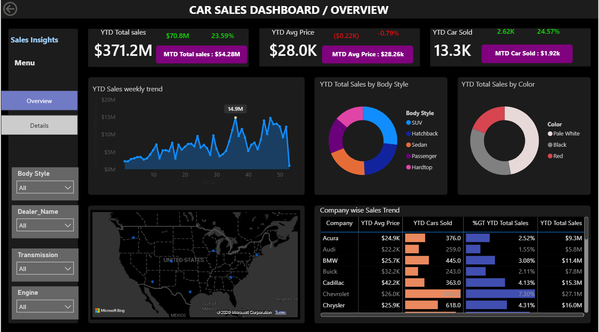
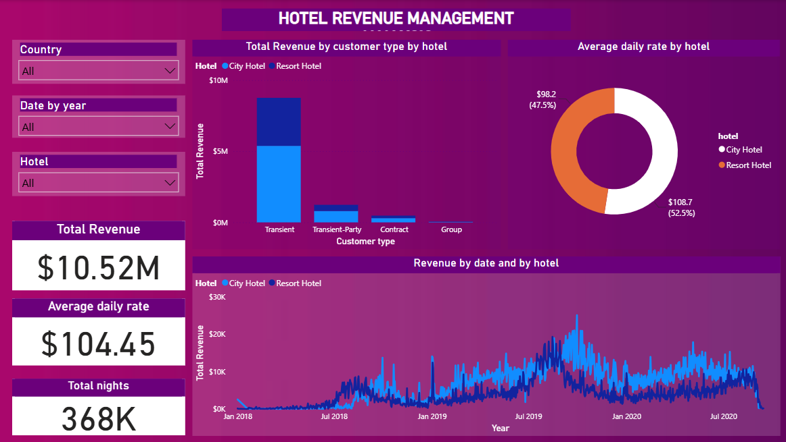
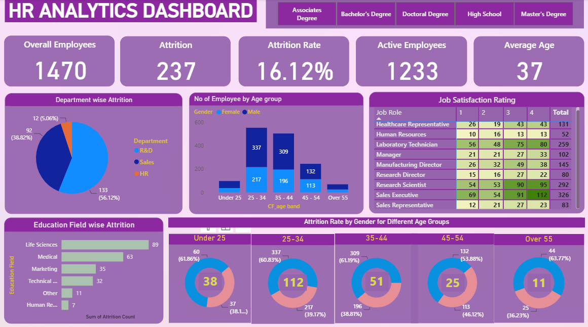

# Data Analysis Portfolio – Power BI, Python & Excel

Hi, I'm **Emmanuella Ukutegbe**, a Data Analyst with a background in Medical Biochemistry. This repository holds a selection of my analysis projects. Each one starts with a business question, cleans the data and ends with insights a team can act on.

## Tools
- **Power BI** – data modelling, DAX measures, KPI cards, slicers and drill-downs
- **Excel** – pivot tables, formulas, dashboards and reporting
- **Python** – Pandas, NumPy, Jupyter notebooks, web scraping (BeautifulSoup, Requests)

## Projects

### 1. Car Sales Performance Dashboard (Power BI) – `CAR SALES 2.pbix`
- **Problem:** Which products, regions and seasons drive revenue?
- **Approach:** Cleaned sales data, built revenue-trend, top-product and regional views with slicers.
- **Impact:** Helped reduce reporting time by 8 hours/week and guided strategy for 20% higher returns.
- **Screenshot:** 

### 2. Hotel Revenue Analysis (Power BI) – `Hotel revenue analysis.pbix`
- **Problem:** How do customer types and booking patterns affect hotel revenue?
- **Approach:** Analysed customer types, room demand and booking trends over time.
- **Impact:** Supported forecasting and revenue planning for a hospitality business.
- **Screenshot:** 

### 3. HR Analytics Dashboard (Power BI) – `Hr analysis.pbix`
- **Problem:** What drives employee retention and turnover?
- **Approach:** Analysed 2,000+ employee feedback responses.
- **Impact:** Helped HR identify key retention factors.
- **Screenshot:** 

### 4. Amazon Web Scraper (Python) – `Amazon web scraper.ipynb`
- Scrapes product information and reviews from Amazon with BeautifulSoup and Requests and saves them for analysis.

### 5. Movie Correlation Analysis (Python) – `Movie correlation project.ipynb`
- Cleans a movies dataset and tests which factors (such as budget) correlate with gross earnings, using Pandas, Seaborn and Pearson/Kendall/Spearman correlation.

## How to open the files
- `.pbix` files: open in **Power BI Desktop** (free download from Microsoft).
- `.ipynb` files: open directly on GitHub, or in Jupyter / Google Colab.

## Contact
📫 ellaukutegbe@gmail.com · 🔗 [LinkedIn](https://www.linkedin.com/in/emmanuella-ukutegbe/) · 🌐 [Portfolio](https://nuella9827.github.io/)

---

## 🔗 About Me
I'm actively learning and applying data analysis skills to solve real-world problems. My projects focus on business insights, automation, and strategic reporting.  
📫 Reach me at [ellaukutegbe@gmail.com](mailto:ellaukutegbe@gmail.com)  
🔗 [LinkedIn](https://linkedin.com/in/emmanuella-ukutegbe-85636a299)
